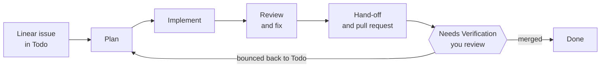
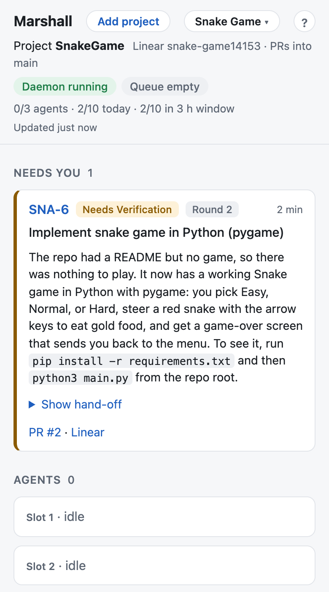

<!-- Last edited: 2026-10-18 13:17 PDT -->

<a id="readme-top"></a>

<!-- PROJECT SHIELDS -->
[![Contributors][contributors-shield]][contributors-url]
[![Forks][forks-shield]][forks-url]
[![Stargazers][stars-shield]][stars-url]
[![Issues][issues-shield]][issues-url]

<!-- PROJECT LOGO -->
<br />
<div align="center">
  <a href="https://github.com/JacquesAttinger/Marshall">
    
  </a>

<h3 align="center">Marshall</h3>

  <p align="center">
    A Linear autopilot that runs Claude Code agents on your issues — plan, implement, and hand off a pull request, while you sleep.
    <br />
    <a href="docs/marshall_plan.md"><strong>Explore the docs »</strong></a>
    <br />
    <br />
    <a href="https://github.com/JacquesAttinger/Marshall/issues/new?labels=bug">Report Bug</a>
    &middot;
    <a href="https://github.com/JacquesAttinger/Marshall/issues/new?labels=enhancement">Request Feature</a>
  </p>
</div>

<!-- TABLE OF CONTENTS -->
<details>
  <summary>Table of Contents</summary>
  <ol>
    <li>
      <a href="#about-the-project">About The Project</a>
      <ul>
        <li><a href="#how-it-works">How it works</a></li>
        <li><a href="#built-with">Built With</a></li>
      </ul>
    </li>
    <li>
      <a href="#getting-started">Getting Started</a>
      <ul>
        <li><a href="#prerequisites">Prerequisites</a></li>
        <li><a href="#installation">Installation</a></li>
      </ul>
    </li>
    <li>
      <a href="#usage">Usage</a>
      <ul>
        <li><a href="#commands">Commands</a></li>
        <li><a href="#dashboard">Dashboard</a></li>
        <li><a href="#projects">Projects</a></li>
        <li><a href="#hosting">Hosting</a></li>
        <li><a href="#agent-runner">Agent runner</a></li>
        <li><a href="#plugin-and-skills">Plugin and skills</a></li>
        <li><a href="#scheduler">Scheduler</a></li>
        <li><a href="#master-agent">Master agent</a></li>
        <li><a href="#further-documentation">Further documentation</a></li>
      </ul>
    </li>
    <li><a href="#roadmap">Roadmap</a></li>
    <li><a href="#contributing">Contributing</a></li>
    <li><a href="#contact">Contact</a></li>
  </ol>
</details>

<!-- ABOUT THE PROJECT -->
## About The Project

[![Marshall dashboard: one issue waiting in Needs you, three idle agent slots][product-screenshot]](images/dashboard.png)

Before Marshall, every Linear issue started the same way.
I opened a terminal, started a Claude Code session by hand, and pasted in the issue.
Marshall removes that step.

It watches a Linear board and picks up issues on its own.
For each one, it runs a Claude Code agent through the full loop: plan, implement, hand off a pull request, and post the result back to Linear.
I create the issue. Marshall does the rest, even while I sleep.
I review the pull request when it lands.

Marshall runs on a laptop or on an always-on Linux server, for one project or several.
You watch it three ways: the CLI, a web dashboard, and your phone.
The dashboard shows what every agent is doing, lists what needs you, and has a Kill button.
It works over [Tailscale](https://tailscale.com), so you can check on Marshall from anywhere.

The goal is bigger than that.
A background agent that never stops picking up new work turns my job from writing code into writing issues — one step toward a fully autonomous software engineer that works around the clock.
See the [roadmap](#roadmap) for where that's headed.

<p align="right">(<a href="#readme-top">back to top</a>)</p>

### How it works



1. **Pick up.** The scheduler polls Linear. It starts the oldest, highest-priority Todo issue that fits the caps (agents at once, starts per day).
2. **Plan, implement, review.** Each issue gets its own git worktree. A Claude Code agent writes a plan, then the code, then runs a review loop and fixes what it finds.
3. **Hand off.** Marshall opens a pull request and writes a hand-off: what changed, how to try it, and what the agent decided on its own. The issue moves to Needs Verification.
4. **You decide.** Merge the pull request and the issue goes to Done. Move the issue back to Todo and Marshall plans a new round on the same branch.

This is the pull request Marshall opened for the Snake Game project, with the hand-off written into its description:

[![A pull request opened by Marshall, with the hand-off in the description][pr-screenshot]](images/pull-request.png)

Marshall also rebases waiting pull requests when a sibling merges, resumes a stalled agent, and stops one that runs too long.
See [`docs/state_machine.md`](docs/state_machine.md) for every state.

<p align="right">(<a href="#readme-top">back to top</a>)</p>

### Built With

* [![Bun][Bun.sh]][Bun-url]
* [![TypeScript][TypeScript.org]][TypeScript-url]
* [![SQLite][SQLite.org]][SQLite-url]
* [![Linear][Linear.app]][Linear-url]
* [![Claude][Claude.ai]][Claude-url]
* [![Biome][Biome.dev]][Biome-url]
* Zod, Husky, and lint-staged for schema validation and pre-commit checks.

<p align="right">(<a href="#readme-top">back to top</a>)</p>

<!-- GETTING STARTED -->
## Getting Started

### Prerequisites

* [Bun](https://bun.sh)
* A [Linear](https://linear.app) workspace and a personal API key
* [Claude Code](https://claude.com/claude-code), signed in

### Installation

```bash
bun install
cp .env.example .env      # put the target workspace's key in MARSHALL_LINEAR_API_KEY
bun run migrate           # creates ~/.marshall/marshall.db
bin/marshall linear setup # creates the Needs Verification state and the marshall labels (once)
bin/marshall status       # prints config, state dir, schema version, row counts
bin/marshall dashboard    # then open http://127.0.0.1:7474
```

The Linear key is `MARSHALL_LINEAR_API_KEY`, not `LINEAR_API_KEY`.
This keeps a different, already-exported `LINEAR_API_KEY` from leaking into the wrong workspace.
See [`docs/linear_setup.md`](docs/linear_setup.md) for the manual steps and the conventions.

State lives in `~/.marshall/` (override with `MARSHALL_HOME`).
Config is `marshall.config.json` at the repo root (override with `--config <path>` or `MARSHALL_CONFIG`).
With more than one project, the [project registry](#projects) picks the config and state folder instead.

<p align="right">(<a href="#readme-top">back to top</a>)</p>

<!-- USAGE EXAMPLES -->
## Usage

Point `marshall.config.json` at a repo and a Linear team, then start the daemon (`bin/marshall run`, or an always-on service: see [Hosting](#hosting)).
From there, the workflow is: create a Linear issue, let Marshall pick it up, and review the pull request it opens.
Watch it from the [dashboard](#dashboard) or with `bin/marshall status` and `bin/marshall logs`.

### Commands

| Command | What it does |
|---|---|
| `bin/marshall status [--json]` | Show config and DB state, then the daemon, the live agents, the queue, and the "needs you" list. Never writes. |
| `bin/marshall start` / `stop` | Load or unload the launchd agent (macOS). On Linux, use `systemctl --user`: see [Hosting](#hosting). |
| `bin/marshall pause` / `resume` | Stop new starts, or allow them again. Running agents always finish. |
| `bin/marshall kill <identifier>` | Stop one issue's agent and mark the issue Blocked. |
| `bin/marshall logs [identifier]` | Tail the orchestrator log, or follow one issue's agent. |
| `bin/marshall dashboard` | Serve the [web dashboard](#dashboard) on `127.0.0.1:<dashboardPort>` (default 7474) until Ctrl-C. |
| `bin/marshall project list` / `use <slug>` / `import …` | Manage the [project registry](#projects). |
| `bin/marshall db migrate` | Create the state dir and apply pending migrations. |
| `bin/marshall linear setup [--json]` | Create the Linear states and labels Marshall needs. Idempotent. Refuses a key from another workspace. |
| `bin/marshall plan <identifier> --cwd <worktree> [--revise] [--json]` | Plan one issue in an existing worktree: classify, launch the planner, verify, post to Linear. |
| `bin/marshall plan check <file>` | Check a plan file for the required sections, in order. |
| `bin/marshall handoff check <file>` | Check a hand-off file: six sections in order, the section 5 sub-lists, a PR URL and a branch in section 6. |
| `bin/marshall enqueue <plan-file> [--dry-run] [--json]` | Queue a finished plan: check it, then file a Todo issue with the plan as its body and the `marshall:queued` and `marshall:has-plan` labels. Marshall skips planning and implements it. See [`docs/hemut_runbook.md`](docs/hemut_runbook.md). |
| `bin/marshall queue [--json]` | Dry-run one scheduler tick: the ordered pickable list and why each issue would or would not start now. Never writes. |
| `bin/marshall run [--once]` | The orchestrator: reconcile, then poll Linear and drive the master agents until Ctrl-C. `--once` does one reconcile + pulse + tick and exits. |
| `bun test` | Run the test suite. |
| `bun run lint` / `bun run format` | Biome check / fix. |
| `bun run typecheck` | `tsc --noEmit`. |
| `bun run check:size` | 500 lines per file, 75 per function. |

The pre-commit hook runs lint-staged (Biome + size check), typecheck, and tests.

<p align="right">(<a href="#readme-top">back to top</a>)</p>

### Dashboard

`bin/marshall dashboard` serves a small web page that shows what Marshall is doing.
It runs as its own program, so it stays up when the daemon stops.
It refreshes every 5 seconds.
It is read-only except for one button: **Kill**.

![Dashboard: SNA-6 in Needs you with its hand-off expanded][needs-you-screenshot]

| Section | Shows |
|---|---|
| Header and status strip | The active project, whether the daemon runs, agent slots in use, and the daily and rolling-window start caps. |
| Needs you | Issues waiting on a person (Needs Verification or Blocked), each with a plain summary, the PR and Linear links, and the hand-off. |
| Agents | One card per slot: issue, phase, model, elapsed time, tokens, the agent's last action, and a two-tap Kill button. |
| Queue | The issues the next scheduler tick would pick up, and why the others wait. |

The `?` button opens a panel of copy-paste commands for checking on Marshall from a terminal.
The page is also usable at phone width:

<p align="center">
  
</p>

See [`docs/dashboard.md`](docs/dashboard.md) for what each section means, the Kill flow, and phone access over Tailscale.

### Projects

Marshall can watch more than one project.
Each project has its own Linear workspace, repo, config, and state folder.
One project is active at a time, and the CLI, the daemon, and the dashboard all follow it.

![The project menu, listing two projects with a Switch button][switcher-screenshot]

```bash
bin/marshall project list                  # * marks the active project
bin/marshall project use <slug>            # change the active project, then restart the services
bin/marshall project import --name <name> <config-path>
```

You can do the same from the dashboard.
**Switch** changes the active project, and the dashboard refuses while any agent is still working.
**Add project** creates a new one from your phone: paste a Linear API key, pick a team, and choose a new private GitHub repo or an existing one.

![The Add a project dialog][add-project-screenshot]

See "Projects" in [`docs/runbook.md`](docs/runbook.md) for the registry and [`docs/dashboard.md`](docs/dashboard.md) for the dashboard flows.

### Hosting

| Where | How |
|---|---|
| Mac laptop | `scripts/install-launchd.sh` installs Marshall as a launchd agent. `scripts/install-launchd.sh dashboard` adds the dashboard as its own job. |
| Linux server or VM | `scripts/install-systemd.sh` installs Marshall as a systemd user service. Copy `scripts/systemd/marshall-dashboard.service` for the dashboard. Marshall has run on an Oracle Always Free VM this way: see [`docs/oracle_hosting_plan.md`](docs/oracle_hosting_plan.md). |
| Your phone | Install [Tailscale](https://tailscale.com) on the server and the phone. `scripts/tailscale-serve.sh` shares the dashboard on your private tailnet only, never on the public internet. Set `tailscaleUsers` in the config to limit it to your own login. |
| From a laptop to a server | `scripts/vm-dashboard.sh` opens an SSH tunnel to the server's dashboard. |

The dashboard listens on `127.0.0.1` only, and it rejects any `Host` name other than `localhost`, `127.0.0.1`, and `*.ts.net`.
Run the install scripts from the main checkout, never from a worktree.
See [`docs/runbook.md`](docs/runbook.md) for start, stop, pause, and recovery.

### Agent runner

Each agent launch passes a `--settings` JSON whose hooks append one JSON line per event to `~/.marshall/events/<runId>.jsonl`.
The runner watches that folder, writes the lines into the `events` table, and runs `claude stop` when the agent's turn ends.
`bun test` covers the runner with a fake `claude` shim.
`MARSHALL_LIVE=1 bun test tests/runner.live.test.ts` runs four real agents against the daemon (about 30 s, needs `claude` logged in).
See [`docs/runner.md`](docs/runner.md) for the exact command line and what each lifecycle state looks like.

### Plugin and skills

`plugin/` is a Claude Code plugin named `marshall` (`plugin/.claude-plugin/plugin.json`).
Agents launch with `--setting-sources project,local`, which never loads `~/.claude/skills/`, so every skill an agent needs lives under `plugin/skills/` here and is loaded per launch with `--plugin-dir <repo>/plugin`.
It is not the repo root because a plugin root's `bin/` goes on the agent's `PATH`, and `bin/marshall` is not for agents.

| Skill | Does |
|---|---|
| `/marshall:plan <brief>` | The autonomous planner; see [`docs/planning.md`](docs/planning.md). |
| `/marshall:implement <plan-path> <ISSUE-ID>` | Plan → commits → local gate → PR → CI → `/marshall:review` → fixes, up to `maxFixCycles` times. Always ends with a PR; a red run leaves a draft whose body starts with `## Still failing`. |
| `/marshall:review <plan-path>` | The built-in `/code-review` bug hunt plus a Spec pass against the plan. `CONFIRMED` findings and spec gaps block; `PLAUSIBLE` ones are notes. |
| `/marshall:handoff <plan-path> <ISSUE-ID>` | The read-only hand-off writer: six sections from the plan, the diff, and the PR into `~/.marshall/handoffs/<ISSUE-ID>.md`; see [`docs/handoff.md`](docs/handoff.md). |
| `/marshall:implement-hemut <plan-path> <ISSUE-ID>` | The Hemut version of implement (`implementSkill` in the config): Hemut policy, one PR per repo a plan touches, never merges. |
| `/marshall:resolve-conflicts <plan-path> <ISSUE-ID> <conflict\|ci>` | After a sibling PR merged: finish the rebase the orchestrator started (conflict mode) or fix the red CI it left (ci mode), then the full done gate. |

<p align="right">(<a href="#readme-top">back to top</a>)</p>

### Opt-in pick-up, several repos, and the overnight queue

Three config settings let Marshall run unattended against a workspace with real work in Todo, such as Hemut's.

- `pickup: "labeled"` takes only issues that carry `marshall:queued`. The default, `"assigned"`, takes every Todo issue assigned to you.
- `repos` lists several repos (slug, path, base branch). A plan names the repos it touches in a `## Repos touched` section, and Marshall opens one worktree and one PR per repo on one branch. The PR is merged only by a human.
- `marshall enqueue` queues a finished plan. A `marshall:has-plan` issue skips the planner.

Agents also run behind a guard (`scripts/merge-guard.ts`) that denies `gh pr merge`, approvals, and pushes to a protected branch.
See [`docs/hemut_runbook.md`](docs/hemut_runbook.md) for the whole flow and [`docs/hemut_overnight_queue_plan.md`](docs/hemut_overnight_queue_plan.md) for the design.

### Scheduler

`src/scheduler/` is the loop that decides when work starts.
`startLoop` reconciles once, then ticks every `pollSeconds`.
A tick lists the pickable issues (Todo, assigned to me), orders them by priority then age, and for each one in turn:

1. Skips it while a claim row is still live, or blocks it when it has bounced `maxBounces` times.
2. Checks the caps in `src/caps.ts`: `maxAgents` live claims, `dailyStartCap` starts on the local calendar day, `windowStartCap` starts in the last `windowHours`.
3. Writes a `claiming` row, claims in Linear, creates the worktree (a sibling `<repo>-<branch>` off `origin/<baseBranch>` with `.env` copied in), and starts the agent.

`bin/marshall queue` shows exactly what the next tick would do.

### Master agent

`src/master-agent.ts` runs one issue through plan → implement → hand-off, enforces the wall-clock limit, resumes a stalled agent, rebases parked pull requests when a sibling merges, and moves an issue to Done once its pull request merges.
Every state lives on the claim's row, so `bin/marshall run` after a crash reconciles and continues from where each issue was.
See [`docs/state_machine.md`](docs/state_machine.md) for the full diagram.

### Further documentation

- [`docs/marshall_plan.md`](docs/marshall_plan.md) — the spec.
- [`docs/steps/`](docs/steps/) — iteration 1 build steps.
- [`docs/linear_setup.md`](docs/linear_setup.md) — what is configured in Linear and why.
- [`docs/planning.md`](docs/planning.md) — planning phase: the brief, the skill, the classifier, the post-run checks.
- [`docs/isolation.md`](docs/isolation.md) — slot → Compose project → ports, and how the env reaches an agent.
- [`docs/handoff_template.md`](docs/handoff_template.md) — what each of the six hand-off sections is for.
- [`docs/dashboard.md`](docs/dashboard.md) — the web dashboard: what each section means, Kill, switching and adding projects, and phone access over Tailscale.
- [`docs/hemut_runbook.md`](docs/hemut_runbook.md) — the overnight plan queue for the Hemut repos: enqueue, multi-repo plans, never merge, VM setup.
- [`docs/runbook.md`](docs/runbook.md) — install, projects, start/stop/pause/kill, notifications, and recovery.
- [`docs/oracle_hosting_plan.md`](docs/oracle_hosting_plan.md) — running Marshall on an always-on Oracle VM.
- [`docs/state_machine.md`](docs/state_machine.md) — every claim state and the pulse.
- [`plugin/README.md`](plugin/README.md) — the skills agents run, and how to try them by hand.

<p align="right">(<a href="#readme-top">back to top</a>)</p>

<!-- ROADMAP -->
## Roadmap

- [x] Iteration 1 — Linear autopilot on one repo: poller, planner, implementer, reviewer, hand-off package, ntfy.sh push
- [x] Iteration 2 — Web dashboard (queue, hand-off cards, kill switch): `marshall dashboard`, see [`docs/dashboard.md`](docs/dashboard.md)
- [x] Iteration 2 — Phone access over Tailscale, with an optional per-login allow list
- [x] Iteration 2 — Always-on hosting on a Linux VM (systemd), plus an SSH tunnel to its dashboard
- [x] Iteration 2 — Multiple projects: a project registry, a project switcher, and Add project from the dashboard
- [ ] Iteration 2 — Raise the agent cap, Linear OAuth status
- [ ] Iteration 3 — Voice intake: an iOS Shortcut turns a spoken note into a well-formed Linear issue
- [ ] Iteration 4 — Marshall proper: open-ended goals split into issues on their own, two-way chat instead of a CLI, an always-on machine
- [ ] Later — a Testing agent that scans the repo, finds bugs on its own, and proposes fixes the same way the Innovate agent proposes features

See [`docs/marshall_plan.md`](docs/marshall_plan.md) for the full plan and the [open issues](https://github.com/JacquesAttinger/Marshall/issues) for what's in flight now.

<p align="right">(<a href="#readme-top">back to top</a>)</p>

<!-- CONTRIBUTING -->
## Contributing

This started as a personal tool, but suggestions and pull requests are welcome.

1. Fork the Project
2. Create your Feature Branch (`git checkout -b feature/AmazingFeature`)
3. Commit your Changes (`git commit -m 'Add some AmazingFeature'`)
4. Push to the Branch (`git push origin feature/AmazingFeature`)
5. Open a Pull Request

The pre-commit hook (lint, typecheck, tests) runs on every commit — see [Commands](#commands).

<p align="right">(<a href="#readme-top">back to top</a>)</p>

<!-- CONTACT -->
## Contact

Jacques Attinger - [@JacquesAttinger](https://github.com/JacquesAttinger) - jacques.attinger@gmail.com

Project Link: [https://github.com/JacquesAttinger/Marshall](https://github.com/JacquesAttinger/Marshall)

<p align="right">(<a href="#readme-top">back to top</a>)</p>

<!-- MARKDOWN LINKS & IMAGES -->
[contributors-shield]: https://img.shields.io/github/contributors/JacquesAttinger/Marshall.svg?style=for-the-badge
[contributors-url]: https://github.com/JacquesAttinger/Marshall/graphs/contributors
[forks-shield]: https://img.shields.io/github/forks/JacquesAttinger/Marshall.svg?style=for-the-badge
[forks-url]: https://github.com/JacquesAttinger/Marshall/network/members
[stars-shield]: https://img.shields.io/github/stars/JacquesAttinger/Marshall.svg?style=for-the-badge
[stars-url]: https://github.com/JacquesAttinger/Marshall/stargazers
[issues-shield]: https://img.shields.io/github/issues/JacquesAttinger/Marshall.svg?style=for-the-badge
[issues-url]: https://github.com/JacquesAttinger/Marshall/issues
[product-screenshot]: images/dashboard.png
[needs-you-screenshot]: images/needs-you.png
[switcher-screenshot]: images/project-switcher.png
[add-project-screenshot]: images/add-project.png
[pr-screenshot]: images/pull-request.png
[Bun.sh]: https://img.shields.io/badge/Bun-000000?style=for-the-badge&logo=bun&logoColor=white
[Bun-url]: https://bun.sh
[TypeScript.org]: https://img.shields.io/badge/TypeScript-3178C6?style=for-the-badge&logo=typescript&logoColor=white
[TypeScript-url]: https://www.typescriptlang.org/
[SQLite.org]: https://img.shields.io/badge/SQLite-003B57?style=for-the-badge&logo=sqlite&logoColor=white
[SQLite-url]: https://www.sqlite.org/
[Linear.app]: https://img.shields.io/badge/Linear-5E6AD2?style=for-the-badge&logo=linear&logoColor=white
[Linear-url]: https://linear.app
[Claude.ai]: https://img.shields.io/badge/Claude_Code-D97757?style=for-the-badge&logo=anthropic&logoColor=white
[Claude-url]: https://claude.com/claude-code
[Biome.dev]: https://img.shields.io/badge/Biome-60A5FA?style=for-the-badge&logo=biome&logoColor=white
[Biome-url]: https://biomejs.dev/
